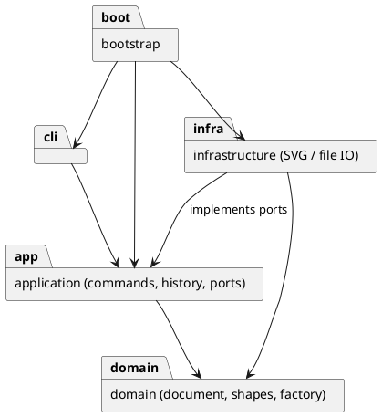

# Lab1 Phase 1：SVG 编辑器（CLI）

## 项目信息

- Git 仓库地址：https://github.com/fffuting/svg-editor-cli
- Git 克隆地址：https://github.com/fffuting/svg-editor-cli.git
- 提交文档路径：`doc/README.md`
- 技术要求：TypeScript、面向对象、Command 模式、Composite 语义。
- 当前状态：仓库已创建，本文为实施前的架构方案。尚未提交程序实现、执行测试或创建 `final` 标签，因此本文不是已完成项目的验收报告。
- 仓库为私有，评阅者需要具备访问权限。

## 架构方案

### 1. 模块划分

以下目录与类名为计划结构；实现后须按实际代码修订。一类一文件，文件名与类名一致，状态通过私有字段和方法封装。

| 模块 | 计划职责与代表类 |
| --- | --- |
| `src/cli/` | `Repl` 逐行读取命令；`Tokenizer` 处理双引号及行首注释；`CommandDispatcher` 将命令名映射为命令对象；统一输出成功摘要与 `error:` |
| `src/application/` | `EditorSession` 管理当前文档、路径及历史屏障；`CommandHistory` 管理 undo/redo；协调业务对象与 IO 接口 |
| `src/application/commands/` | `CreateCommand`、`MoveCommand` 等具体命令；每条编辑命令作为一个撤销单元 |
| `src/application/ports/` | 定义 `DocumentStore` 等 IO 接口，避免业务直接依赖 Node 文件系统 |
| `src/domain/` | `SvgDocument` 维护画布、唯一 id 与树结构不变量；`Shape` 及 Rect、Circle、Ellipse、Line、Text、Group 类封装图形操作；`ShapeFactory` 集中创建图形 |
| `src/infrastructure/` | `SvgDocumentStore` 读写文件；SVG XML 解析与序列化适配，处理文本转义与缺失 id 警告 |
| `src/bootstrap/` | 组装 CLI、会话、工厂及存储实现，完成依赖注入 |
| `tests/` | 图形行为、命令历史、SVG 往返、CLI 集成与错误原子性测试 |
| `doc/` | 架构、迭代记录、自查和质量保证文档 |

### 2. 设计模式的选择

**Command（必选）**：计划定义编辑命令抽象，提供执行、撤销和重做能力。调用方只提交命令对象，`CommandHistory` 统一维护历史。命令成功后才入栈；失败必须恢复文档、父子关系、id 索引及历史状态。undo 后成功执行新编辑时清空 redo 栈，失败编辑不清空历史。

`group`、`ungroup`、`addto`、`delete` 保存原父节点、同级位置和相关子树，以便精确恢复。首版可采用由领域对象生成及恢复的深快照（Memento），同时保存成功执行后的快照以支持重做；代价是内存随文档和历史增长，后续有证据表明需要时再改为局部差量。

**Composite**：`Shape` 定义 move、scale 和属性操作契约。叶子类自行处理几何数据，`Group` 持有子节点并递归移动、缩放。容器的公共样式属性设置在容器本身，采用 SVG 继承语义，不强制覆盖子节点显式样式。删除容器同时删除子孙；应用层不根据图形标签反复分派行为。

**工厂与依赖倒置**：`ShapeFactory` 是图形类型名到类的唯一分派点；命令名分派仅位于 `CommandDispatcher`。两处均记录为后续注册式扩展的待重构点。XML 读取复用同一图形创建入口；写出与展示通过多态协作，避免散落 `switch(tag)`。

以上为计划落地方式，尚无源码可供证明。

### 3. 依赖方向规则

- `domain` 不依赖 CLI、应用服务、文件系统和第三方 XML 解析库，保持图形规则可独立测试。
- `application` 可以依赖 `domain` 和自身的 ports，不依赖具体存储实现。
- `cli` 只调用应用层，不直接修改图形集合、文件或历史栈。
- `infrastructure` 可以依赖领域对象和应用层 ports，实现存储接口；不得调用 CLI。
- `bootstrap` 可以依赖各模块，负责组装对象，不承载编辑规则。
- `tests` 可依赖被测模块，生产代码不得反向依赖测试。

违反上述规则的 import 必须记录为待处理项，并在最终提交前修复或说明经过评估的方案修订。

### 4. 变化点假设

| 可能变化 | 预留方式或不预留的理由 |
| --- | --- |
| 新增编辑命令 | 命令对象与历史管理分离；新增命令不修改历史算法 |
| 新增图形、后续 box 插件 | 统一 Shape/Group 契约和集中工厂；本阶段不实现插件装载器，避免扩大范围 |
| CLI 改为 GUI 或 agent 调用 | 输入解析、输出格式与应用服务分离，复用会话和命令 |
| 存储位置或 XML 库替换 | 通过 DocumentStore 接口隔离；领域不依赖解析器节点 |
| 大文档与长撤销历史 | 首版使用快照，性能测量后再引入局部差量和历史上限 |

### 5. 关键行为约束

- 内置 rect、circle、ellipse、line、text、g 六种类型；`box` 属后续阶段，本阶段返回未知类型错误。
- 所有图形及容器的 id 唯一且大小写敏感。外部文件缺 id 时先收集已有 id，再分配不冲突的“标签名+序号”，并打印警告。
- `create ... in <containerId>` 直接指定父容器；group 收编已有节点，addto 将已有节点追加到目标容器。
- scale 仅接受正数，位置与尺寸同时缩放；Group 对子孙递归操作，不能只缩放宽高。
- group 拒绝同时收编祖先与后代；addto 拒绝形成环；ungroup 拒绝根级容器，其他容器解散后子节点占据其原位置。
- front/back 仅调整同级顺序，按 SVG 后绘制覆盖先绘制的规则处理。
- set 仅接受要求中的公共样式、各类几何属性和 text 内容，禁止通过 set 修改 id 或任意属性。
- init、read、save、修改画布尺寸成功后形成历史屏障，undo/redo 报 `error: undo not allowed after io command`；下一条成功编辑重新开启历史，不能跨越屏障撤销。
- tree、show、help 以及查询画布尺寸不进入历史；失败命令不改变任何状态。
- 读入先解析和验证临时文档，成功后再替换会话。写入失败不改变当前文档或历史状态。

## 过程记录

### 本次实际发生的讨论与修订

1. 阅读 `phase_cli_1 (1).md`，提取四项必需文档内容，确认 Command 为强制要求、box 不在本阶段范围内。
2. 初次处理时要求提供已有仓库；用户明确提出由助手创建仓库，随后完成 GitHub 登录。
3. 在账号 fffuting 下创建私有仓库 svg-editor-cli，依据创建结果页核实仓库克隆地址。
4. 由于没有已有源码和测试结果，文档将类名、目录、设计模式落地方式标为计划，避免将设计描述冒充实现证据。

### 后续开发记录要求

每次关键迭代记录：发现的问题、最小复现或需求依据、选择的修正方案、实际修改文件、验证结果及对应 commit。当前尚无代码迭代记录，不编造 AI 生成代码的缺陷、测试通过率或提交历史。

## 一致性自查

| 自查问题 | 当前结论 | 实现后的检查方法 |
| --- | --- | --- |
| 实际模块与方案一致吗？ | 未实现，无法判定 | 对照实际 src 目录与上方模块表，记录新增、合并、迁移模块及原因 |
| 是否违反依赖方向？ | 未实现，尚未检查 import | 检查所有跨模块 import；重点抽查 MoveCommand、CommandHistory、SvgDocumentStore、Repl |
| 是否采用面向对象与一类一文件？ | 待验证 | 检查私有字段、行为封装、多态及类名与文件名对应关系 |
| 是否只有两处按名字分派？ | 待验证 | 检查命令分派、图形工厂及 XML 读写/展示路径是否存在重复标签分派 |
| 文档与实现不一致是否有修订记录？ | 尚无实现修订 | 每次方案调整更新本节、依赖图和过程记录 |

## 质量保证手段

以下为验收计划，尚未执行，不能据此声称代码完整或测试通过。

| 验证范围 | 必须覆盖的用例 |
| --- | --- |
| 文档操作 | 默认 800×600、指定尺寸、read/save、无路径 save、画布查询与修改、未初始化错误 |
| 六类图形 | 创建、浮点坐标、默认样式、带空格与中文文本、合法及非法属性 |
| 树结构 | 多层 in、跨父节点 group、ungroup 位置恢复、addto、容器删除、同级 z-order |
| 几何行为 | 叶子及容器 move/scale，位置和尺寸同时缩放，非正 factor 拒绝 |
| 历史 | 每条编辑一个单元、复合操作一次撤销、redo 分支清空、IO 屏障、查询不污染历史 |
| 错误原子性 | 重复/缺失 id、非法父容器、形成环、祖先后代同组、文件错误；比较操作前后文档与历史 |
| SVG 往返 | save→read 保持尺寸、层次、顺序、id、几何、样式与文本；XML 转义及缺 id 警告 |
| CLI 集成 | 回放需求中的基础会话和两节点流程图版本 A；检查提示符、注释、错误前缀和摘要 |
| 架构质量 | TypeScript 类型检查、依赖方向、一类一文件、领域状态封装及分派点审查 |
| 浏览器预览 | 打开实际保存的 SVG，确认节点、文字与连线可正常渲染 |

实现后在 package.json 中配置并实际运行构建、类型检查和测试脚本，在此补充命令、日期、运行环境、通过/失败数量、失败处理和提交哈希。当前没有 package.json，因此不提供未经验证的安装或运行命令。

## 最终提交核对

- [x] 已建立 GitHub 仓库并在本文填写地址。
- [x] 本文包含架构方案、PlantUML 图、过程记录、一致性自查与质量保证计划。
- [ ] 按阶段实现并提交源代码，真实保留开发过程，禁止伪造历史或一次性大提交。
- [ ] 执行测试、修复问题并将本文更新为实际实现说明。
- [ ] 确保评阅者能够访问私有仓库。
- [ ] 在最终通过验收的提交上创建并推送 `final` 标签，确认早于课程截止时间。

课程截止时间尚未提供；当前不创建 final 标签，以免把仅含方案文档的状态误标为完成版本。
