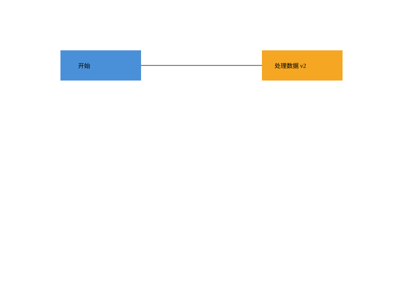
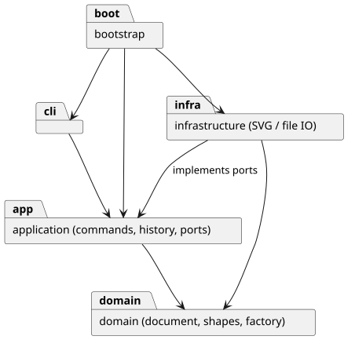
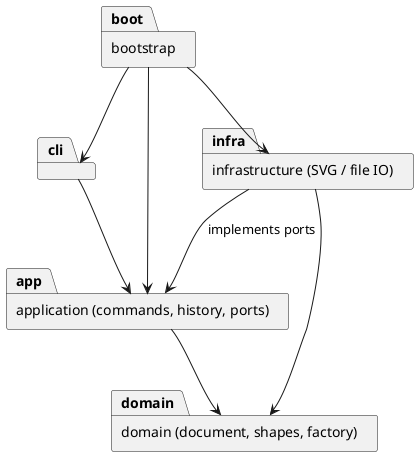

# Lab1 Phase 1：SVG 编辑器（CLI）

## 项目信息与运行

- Git 仓库：https://github.com/fffuting/svg-editor-cli
- 克隆地址：https://github.com/fffuting/svg-editor-cli.git
- 最终交付标签：`final`（最终交付以远程标签指向的提交为准）。
- 环境：Node.js 22+ 和 npm；本地验证 Node.js 24.22.1、TypeScript 5.9.3。
- 实现范围：Phase 1 全部 19 个命令、六种内置图形、撤销重做及 SVG 读写。box 属后续插件阶段，按要求返回未知类型错误。
- 仓库为私有：提交时需确保评阅者能访问；也可同时提交源码 ZIP。本文不代表已向课程平台提交作业。

```sh
git clone https://github.com/fffuting/svg-editor-cli.git
cd svg-editor-cli
git checkout final
npm ci
npm run check
npm run cli
```

`npm run cli` 启动已编译程序，首次运行前需执行 `npm run build` 或 `npm run check`。提示符为 `svg>`，输入 `help` 查看语法；Ctrl+C 或 EOF 退出。浮点坐标合法，id 大小写敏感。双引号包裹含空格参数，行首 `#` 为注释，颜色参数中的 `#` 不作注释。

PowerShell 示例回放：`Get-Content examples/flowchart.txt -Encoding utf8 | npm run cli`。
Linux/macOS：`npm run cli < examples/flowchart.txt`。
生成文件为 `examples/flowchart.svg`，可直接拖入浏览器预览；`examples/other.svg` 用于验证外部文件的缺 id 补全。



## 架构方案

### 1. 模块划分

| 目录 | 实际职责与代表类 |
| --- | --- |
| src/domain | Shape、GeometryShape 与 Rect/Circle/Ellipse/Line/Text/Group；封装几何行为、样式和子树；SvgDocument 负责画布、id 唯一性、父子关系与顺序；ShapeFactory 创建具体类型 |
| src/application | EditorSession 管理当前文档、文件路径和历史屏障；CommandHistory 管理两栈；Arguments 校验命令参数 |
| src/application/commands | Command、EditCommand 和 19 个具体命令类，执行不同用例；一条编辑对应一个历史单元 |
| src/application/ports | DocumentStore 定义读写端口和 ReadResult，应用层不依赖文件系统 |
| src/cli | Tokenizer、CommandDispatcher、Repl；负责解析、命令分发、逐行输入和结果输出 |
| src/infrastructure | SvgCodec 适配 XML 库；SvgTransform 处理支持的平移和等比缩放；SvgDocumentStore 负责文件读写 |
| src/bootstrap | main.ts 仅组装对象并启动 REPL |
| tests | 领域、命令、SVG、真实子进程 CLI、架构静态检查 |
| examples | 可回放命令和实际生成的 SVG |



组件关系的 PlantUML 源码如下：



### 2. 设计模式及落地

**Command**：所有 CLI 命令继承 Command。编辑命令继承 EditCommand，实现 perform(document)，例如 MoveCommand、GroupCommand。CommandDispatcher 只负责构造与调用，不实现图形编辑算法。

**Memento**：EditorSession.edit 在当前文档的深克隆副本上执行命令，成功后 EditCommand.capture 保存前后快照，再替换当前文档并记录历史。异常直接丢弃副本，历史不变。undo/redo 恢复独立深克隆，整次 group、delete 或 ungroup 只占一个单元。

**Composite**：Shape 提供 move、scale、set、clone、children、toElement 等统一契约。GeometryShape 封装数值属性，具体图形负责移动坐标及显示。Group 持有私有子节点数组，移动和缩放递归调用子节点；SvgDocument 删除任意节点时整体移除其子树。调用方不按标签反复分派行为。

**工厂与依赖倒置**：ShapeFactory 集中六种类型的创建规则，CLI 创建与 SVG 读入复用同一工厂；DocumentStore 是应用层端口，SvgDocumentStore 是具体适配器，由 bootstrap 注入。

按名字分派只集中在两处：CommandDispatcher 的命令映射和 ShapeFactory 的图形定义映射。两处标记为后续插件阶段的待重构点，届时改为提供者注册；本阶段不添加插件装载器。

### 3. 依赖方向规则

- domain 只依赖 domain，不导入文件系统、XML 库或应用服务。
- application 依赖 domain 和自身 ports，不依赖 infrastructure 或 cli。
- cli 依赖 application 及自身模块；终端 IO 属于界面层，图形状态修改必须经应用层。
- infrastructure 依赖 domain 与 application/ports，实现具体读写，不依赖 cli。
- bootstrap 负责组装，可依赖各模块，不承载业务规则。
- tests 可导入被测模块，生产代码不得反向依赖测试。

`tests/architecture.test.ts` 遍历源文件 AST，检查静态 import 方向、每文件最多一个同名类、字段可见性、无显式 any、无 switch、无顶层过程式函数。该检查不能证明所有运行时关系，仍需代码审阅。

### 4. 变化点假设

| 变化点 | 当前安排与取舍 |
| --- | --- |
| 新增编辑命令 | 新建命令子类并登记映射；无需更改历史算法 |
| 新增图形和 box | 统一 Shape/Group 契约与工厂；插件注册、复合类型标记还原留到后续阶段 |
| GUI 或 agent 输入 | 复用应用层会话及命令，替换 CLI 适配层 |
| 更换存储或 XML 库 | DocumentStore 端口及 SvgCodec 隔离具体实现 |
| 大文档与长历史 | 当前快照方案空间复杂度约 O(历史条数×节点数)，查找采用树遍历；不提前引入索引同步和差量恢复复杂度 |

### 5. 行为决策与边界

- create 支持尾部 `in <containerId>`；group 保持文档先序顺序，不按参数排列重排节点。
- 跨父容器 group 放入最低共同祖先，在首个被选节点所属分支前插入新容器；同父情况占据首个被选节点位置。原空容器保留。该细节是需求未明确处的确定性选择，已有测试。
- ungroup 拒绝 SVG 直接子容器，其他容器的子节点提升到原容器位置。addto 追加至目标末尾，并拒绝形成环。
- front 移到同级数组末尾（最后绘制），back 移到开头。容器 set 样式采用 SVG 继承，不覆盖子节点显式样式。
- scale 同时缩放位置和尺寸；拒绝零、负数、非有限值。宽高和半径不得为负。
- init/read/save/canvas 修改成功后清空两栈并设历史屏障；下一条成功编辑解除屏障。查询 canvas、tree/show/help 不影响历史。
- help 可在没有文档时查看，其余需文档的操作统一返回 no document 错误。错误前缀为 error:，失败不改变会话状态。
- read 先完整解析临时文档再替换会话。先收集全部显式 id，再补“标签名+序号”，避免与后面的显式 id 冲突，并逐项警告。
- save 无参数使用最近成功 read/save 路径。写入同目录临时文件后原子重命名；失败不改变当前路径和历史。
- XML 使用解析器和序列化器处理文本转义，不用正则拼接 XML。拒绝 DTD、实体声明、未知图形、非法属性和无法支持的变换，避免静默损坏。
- 支持范围是六类图形及要求中的几何/样式；保留部分常见文字与外观属性。不实现任意 SVG 的 CSS、path、滤镜、渐变、旋转、非等比变换等完整浏览器能力。导入 translate/正等比 scale 转为几何坐标；它不是完整的 SVG 视觉变换引擎（字形及描边缩放不作完整模拟）。

## 过程记录

所有记录来自本次实际实施，未补造历史。

| 阶段/提交 | 实际工作、问题与处理 |
| --- | --- |
| 4f97944 | 创建私有仓库，提交初始架构方案，明确当时尚无代码和测试 |
| 302b410 | 实现六类图形、树结构和领域测试；补上严格 TypeScript 的 Node 类型配置 |
| 9cbde5f | 实现 Command、快照和历史屏障；测试失败编辑及 IO 不清空 redo、容器溢出不泄漏部分修改 |
| a16b2c7 | 接入 XML、文件 IO、REPL 和真实 CLI 集成；发现沙箱系统临时目录不支持 rename，将测试隔离目录放到工作目录，保留正式原子保存实现 |
| 验收迭代 | 修正流程图测试误写的节点数：需求示例实际为 8 个节点；补齐逐命令撤销、错误文本、属性白名单和跨父分组测试 |
| 工具链修订 | 新版 TypeScript 7 不再提供原 AST API，固定为 5.9.3；Node 类型固定 22 系列，以便架构测试和 Node 22+ 环境复现 |
| 最终文档 | 统一格式，记录 43 项测试结果；把初始“计划实现”文档更新为真实实现说明，保留已知边界 |

未采用的复杂方案：先做动态插件系统、用局部差量替换深快照、维护多份可变 id/父节点索引。当前规模下这些方案增加一致性风险，Phase 1 无必要。

## 一致性自查

| 检查项 | 实际结论与证据 |
| --- | --- |
| 模块划分是否一致 | 核心目录与初始方案一致；增加 GeometryShape、Numbers、Arguments、Token/SvgElement DTO、SvgTransform 以分离共性行为与边界适配 |
| 依赖方向是否被违反 | 全部静态 import 自动检查通过，未发现违反规则；领域不依赖 Node/XML 库 |
| Command 是否真实落地 | 所有编辑命令均为 EditCommand 子类；全部编辑命令有完整文档前后快照 undo/redo 比较测试 |
| 面向对象规范 | 源码一类一文件、同名、字段封装、无 any、无 switch、无顶层过程式函数检查通过；bootstrap 是对象组装入口 |
| 两处名字分派 | 命令和图形工厂集中映射；移动、缩放、展示和写出依赖多态 |
| 修订是否记录 | 上文过程记录说明工具链、测试目录、节点计数和新增辅助类的修订 |

## 质量保证手段

2026-10-30 在 Windows / Node.js 24.22.1 上运行 `npm run check`：类型检查通过、Prettier 格式检查通过、构建通过、**43 项测试全部通过，0 失败、0 跳过**。测试原始输出见 [verification.txt](verification.txt)。格式检查不是完整的语义 lint；类型检查、架构测试和功能测试共同提供证据。

| 测试文件 | 验证内容 |
| --- | --- |
| domain.test.ts | 六类图形多态、克隆、嵌套变换、顺序、祖先冲突和非法属性 |
| commands.test.ts | 全部编辑命令逐一 undo/redo、IO 屏障、失败原子性、精确错误、参数、白名单、大小写及跨父分组 |
| svg.test.ts | 六类与文本/样式/viewBox 往返、缺 id、重复 id、非法 XML、未知类型、DTD 拒绝和文件失败 |
| cli.test.ts | 启动实际 Node 子进程，回放两节点流程图，验证错误后继续运行和最终 SVG |
| architecture.test.ts | 静态依赖、类文件命名、字段封装和禁止的语法模式 |

另已实际回放 examples/flowchart.txt，保存 8 节点 SVG。测试并不意味着支持所有 SVG 标准特性；支持范围见上文。

## 提交检查

- 源码、依赖锁文件、测试、示例与本说明均纳入 Git。
- 分阶段提交保留真实开发过程；最终版本通过 `final` 标签定位。
- 从源码包复现：解压后 `npm ci`、`npm run check`、`npm run cli`。
- 用户给出的截止日期为 2026-10-31；标签在 2026-10-30 创建，最终以远程 Git 标签时间为准。
- 提交者须保证评阅者可访问私有仓库，并按课程平台要求提交链接或源码包。


补充复现验证：从 Git 源码归档解压后执行 npm ci 和 npm run check，43/43 测试通过。发现 Git/Windows 换行差异后加入 .prettierrc.json 的 endOfLine:auto，避免平台换行造成格式误报。依赖审计为 0 个已知漏洞。
